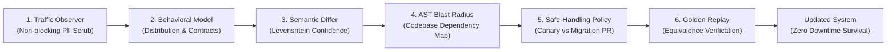

# INTRA — The Autonomous API Resilience Platform
## Pitch Deck & Investor Memorandum

> **Tagline:** The Internet After the API — Helping Modern Software Survive Undocumented Upstream Changes with Zero Production Downtime.  
> **Repository:** [https://github.com/Precise-Goals/Intra.git](https://github.com/Precise-Goals/Intra.git)  
> **Problem Specification:** [`docs/lock.md`](docs/lock.md)  
> **Live Interface:** [http://localhost:3000](http://localhost:3000)

---

## 1. Executive Summary

Modern cloud software does not run in isolation. Every production application relies on an intricate, brittle web of third-party APIs, SDKs, webhooks, and AI MCP servers (Stripe, Twilio, OpenAI, Salesforce, shipping carriers). 

When an upstream dependency quietly alters its behavior—renaming a JSON field from `name` to `display_name`, switching pagination from `offset` to opaque `cursor`, flipping default currencies, throttling rate limits with unexpected `429` headers, or shifting units from dollar floats to integer cents—**production software breaks silently**.

**Intra is the first autonomous runtime resilience platform that intercepts, fingerprints, classifies, isolates, and repairs undocumented API changes in real time before production crashes.**

Instead of relying on outdated, static OpenAPI documentation, Intra establishes **Behavioral Ground Truth** directly from live traffic telemetry, mathematically maps AST blast-radius down to specific source code lines, and dynamically generates backward-compatible TypeScript adapters backed by deterministic **Golden Replay** verification.

---

## 2. The Multi-Billion Dollar Problem

```
┌────────────────────────────────────────────────────────────────────────┐
│                        THE SILENT FAILURE CRISIS                       │
├────────────────────────────────────────────────────────────────────────┤
│  1. Unannounced Breaking Changes:                                      │
│     Over 78% of engineering teams experience unplanned downtime       │
│     annually due to third-party vendor API drift.                      │
│                                                                        │
│  2. Semantic Drift in "Valid JSON":                                    │
│     The response is still HTTP 200 OK and valid JSON, but the meaning  │
│     has shifted (e.g., status "active" silently includes suspended     │
│     users, or amounts change from $25.00 to 2500 cents). Schema        │
│     validators pass, while core financial business logic crashes.      │
│                                                                        │
│  3. The Developer Maintenance Tax:                                     │
│     Engineers spend an estimated 20–30% of their sprints tracking      │
│     upstream vendor deprecations, rewriting wrappers, and debugging    │
│     subtle integration regressions.                                    │
└────────────────────────────────────────────────────────────────────────┘
```

---

## 3. The Intra Solution: The 6-Stage Autonomous Adaptation Loop

Intra operates an end-to-end autonomous adaptation loop that requires zero manual intervention for safe structural shifts:



1. **Non-Blocking Traffic Observer (`@intra/observer`)**: Intercepts request/response telemetry with zero latency impact and 100% SHA-256 PII redaction.
2. **Behavioral Contract Fingerprinting (`@intra/model`)**: Infers real ground truth: status code distributions, optionality, enum sets, error taxonomies, and pagination shapes.
3. **Semantic & Structural Differ (`@intra/differ`)**: Computes sliding-window drift with Levenshtein string similarity and emits typed `Change` events with confidence scores (0.00–1.00).
4. **AST Blast-Radius Mapper (`@intra/impact`)**: Statically parses downstream TypeScript repositories to trace external fields to internal workflows, functions, and lines.
5. **Safe-Handling Policy Matrix (`@intra/adapter`)**: Mathematical decision table:
   - **Confidence ≥ 0.90 + Equivalent**: Auto-applies Canary adapter in-process with unique rollback handle.
   - **0.70 ≤ Confidence < 0.90 or Lossy**: Opens an automated GitHub Migration PR with test suites for human sign-off.
   - **Confidence < 0.70 or Breaking**: Trips automated circuit breaker to quarantine affected endpoints and prevent data corruption.
6. **Golden Test Replay Engine (`@intra/validator`)**: Mathematically replays recorded workflows against adapted payloads to prove semantic equivalence before live activation.

---

## 4. The Six Core Platform Pillars

The entire Intra platform is organized into six unified pillars:

| Pillar | Route | Description |
|---|---|---|
| **1. Home** | `/` | Mission portal, problem orientation (`docs/lock.md`), core philosophy, and system health status. |
| **2. Agent** | `/agent` | Claude-like minimal aesthetic workbench with **Ask Mode** (multilingual via Sarvam AI with prompt suggestions) and **Plan Mode** (structured step-by-step remediation plans), alongside Section 8 CI/CD quality gate enforcement. |
| **3. MCP Server** | `/mcp` | Render-deployed customer Model Context Protocol server exposing 7 discovery & adaptation tools for Claude Desktop, Cursor, and autonomous AI agents. |
| **4. Client SDK** | `/sdk` | `@intra/sdk` client library providing dynamic proxy interception, non-blocking telemetry streaming, and in-browser transformation testing. |
| **5. Docs** | `/docs` | Comprehensive interactive developer documentation, architectural specifications, and exact solution mapping for `docs/lock.md`. |
| **6. Dashboard** | `/dashboard` | The **API Observability Interface** featuring Bento Grid layouts, the pure algorithmic **API Upgrade & Drift Predictor**, live structural diff inspectors, AST blast-radius graphs, and the M1–M10 mutation switchboard. |

---

## 5. Pure Algorithmic Innovation: The API Upgrade & Drift Predictor

Unlike generic monitoring tools that alert developers after production fails, Intra includes a **Preemptive Upgrade & Drift Predictor**:

- **Real Algorithmic Analysis:** Evaluates incoming API schemas and live payloads down to naming conventions, numeric representations, and pagination conventions.
- **CamelCase vs. Snake_case Inconsistency:** Flags mixed naming patterns and quantifies rename probability.
- **Floating-point Currency Vulnerability:** Detects float representations and warns of imminent 100x subunit migrations (cents/pence).
- **Offset Pagination Deprecation:** Detects traditional integer offset/limit patterns and predicts opaque base64 cursor deprecations (85% probability in modern microservices).
- **Loose String Enums:** Detects unconstrained status strings and flags security semantic drift risks.
- **Preemptive Adapter Synthesis:** Synthesizes backward-compatible adapters before the vendor deprecates the endpoint.

---

## 6. Enterprise Security, Cryptographic Ledger & Blockchain Integration

1. **Tamper-Evident SHA-256 Ledger:**
   - Every observation, contract fingerprint, adapter proposal, and golden replay validation generates a cryptographic SHA-256 checksum:
   ```
   [INTRA LEDGER CHECKSUM] sha256:<hex_digest> | seq:<counter> | kind:<event_type> | ts:<iso8601>
   ```
   - Console logs and telemetry feeds expose full mathematical auditability.

2. **Firebase Auth & BridgeKey Wallet Identity Mapping:**
   - **Firebase Authentication & Realtime Database** (`horizon-1ba53`) securely stores user profile metadata.
   - **BridgeKey Wallet on MST Blockchain Testnet** (`https://testnetrpc.mstblockchain.com`, Chain ID `91562037`):
     - Users link their Web3 wallet to their Firebase UID via cryptographic nonce signing.
     - Production adapter approvals can be cryptographically signed by authorized wallet keypairs.

3. **Tiered AI Subscription & NFT Rate Limits:**
   - **Free Tier:** 15 NFT credits / AI adaptation requests.
   - **Starter Tier:** 30 NFT credits / AI adaptation requests.
   - **Business Tier:** 45 NFT credits / AI adaptation requests with high-throughput canary streaming.

---

## 7. Business Model & Market Opportunity

### Target Market
- **API-First SaaS Companies:** Companies with 50+ external SaaS integrations (fintech, logistics, commerce).
- **AI Agent Developers:** Autonomous agent builders who cannot tolerate brittle tool calls breaking mid-workflow.
- **Enterprise Platforms:** Regulated organizations requiring strict audit trails and zero unannounced breaking changes.

### Revenue Streams
1. **Developer SaaS:** Usage-based billing based on monitored endpoints and monthly observed requests.
2. **Enterprise Self-Hosted:** Dedicated in-VPC deployment on Railway/Kubernetes with SLA guarantees.
3. **Web3 / NFT AI Compute Tokens:** On-chain subscription quotas on the MST Blockchain network.

---

## 8. Competitive Advantage (Why Intra Wins)

| Feature | Datadog / New Relic | Speakeasy / Stainless | Intra |
|---|---|---|---|
| **Detection Method** | Latency / 5xx error spikes | Static OpenAPI linting | **Live Behavioral Telemetry** |
| **Semantic Drift in Valid JSON** | ❌ Blind | ❌ Blind | **✅ Full Levenshtein & Distribution Modeling** |
| **AST Codebase Blast Radius** | ❌ No code visibility | ❌ No code visibility | **✅ TypeScript AST Source Line Mapping** |
| **Autonomous Self-Healing** | ❌ Alerts only | ❌ Regenerates SDKs manually | **✅ Zero-Downtime Dynamic In-Process Adapters** |
| **Mathematical Golden Replay** | ❌ None | ❌ None | **✅ Strict Equivalence Replay Proofs** |
| **Customer MCP Server** | ❌ None | ❌ None | **✅ 7 Tools for Claude & Cursor** |
| **Cryptographic Audit Ledger** | ❌ None | ❌ None | **✅ SHA-256 Hash Chain + BridgeKey Wallet** |

---

## 9. Conclusion & Call to Action

The modern web is too dynamic for brittle static schemas. Software must possess the biological resilience to adapt to upstream changes in systems it does not control.

**Intra transforms external dependencies from production liabilities into self-healing assets.**

- **Try the Interactive Dashboard:** [http://localhost:3000](http://localhost:3000)
- **Review Problem Specification:** [`docs/lock.md`](docs/lock.md)
- **Inspect Full Ecosystem Guide:** [`guide.md`](guide.md)
