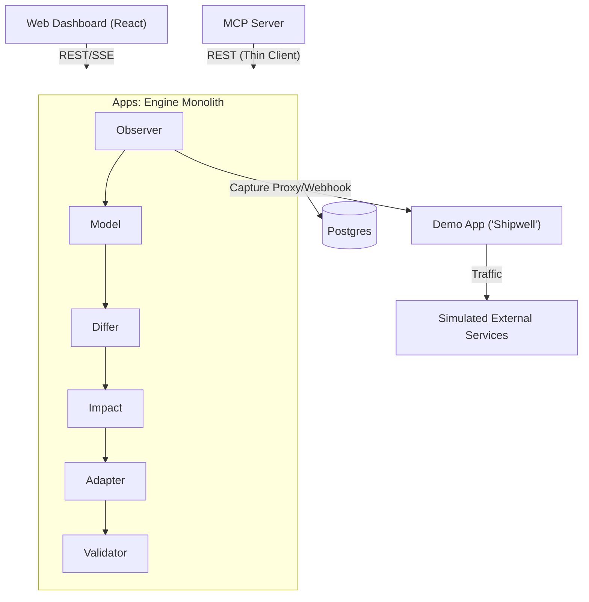
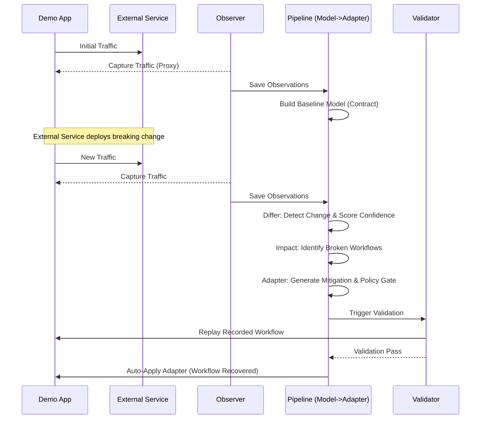
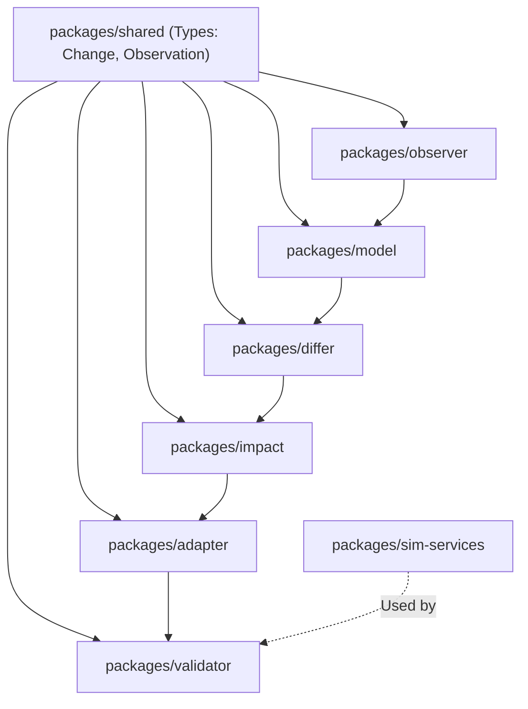
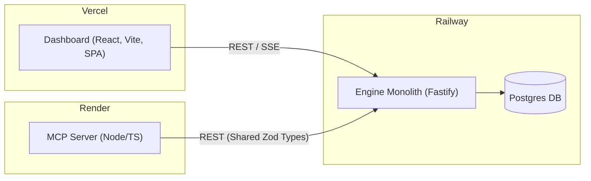

# Architecture & Pipeline Deep-Dive

## 1. System Overview

Intra is designed as a behaviour-first system that learns external service contracts from live traffic, detects semantic and structural drift, analyzes impact, and safely auto-adapts dependencies to restore broken workflows.

## 2. Pipeline Deep-Dive

### Observer (`packages/observer`)
- **Role:** Captures real traffic asynchronously (HTTP requests/responses, webhook payloads, MCP traffic).
- **Mechanism:** Can act as an HTTP capture proxy, an SDK wrapper, or a webhook receiver.
- **Inputs/Outputs:** Takes raw traffic, performs PII redaction, and stores as `Observation` records.
- **Key aspects:** Records status, headers, body, latency, rate-limit headers, pagination shape, and error bodies.

### Model (`packages/model`)
- **Role:** Builds behavioural models based strictly on observations, avoiding reliance on static schemas alone.
- **Mechanism:** Infers schema structures (types, nullability, enums, formats), and constructs a **behavioural fingerprint** (value distributions, default detection, cardinalities).
- **Inputs/Outputs:** Analyzes `Observations` and generates per-endpoint `Contracts` (schema stats, error taxonomy, pagination style, rate-limit policy).

### Differ (`packages/differ`)
- **Role:** The change detection engine and semantic classifier.
- **Mechanism:** Compares baseline models with new observed windows. Detects structural changes and semantic drift (renames, unit shifts, enum meaning changes, default flips, format/timezone shifts). Evaluates behavioural diffs (pagination swaps, error shape changes, silent truncation, rate limits, latency shifts).
- **Inputs/Outputs:** Outputs typed `Change` records with a confidence score and a semantic verdict (`equivalent | lossy | breaking | unknown`).

### Impact (`packages/impact`)
- **Role:** Maps dependencies and analyzes the blast radius of a change.
- **Mechanism:** Combines static dependency scanning (AST parsing for field usage per workflow) with runtime trace correlation to build a precise workflow graph.
- **Inputs/Outputs:** Takes `Change` records and answers "what breaks if this field disappears?", producing `Impact` reports mapping workflows → endpoints → fields.

### Adapter (`packages/adapter`)
- **Role:** Generates mitigation code mapping layers.
- **Mechanism:** Includes generators for renaming, transforming (units/formats), default injection, pagination normalizing, and retry/backoff adjustment. Uses the safe-handling policy engine to decide actions based on confidence and semantic severity.
- **Inputs/Outputs:** Generates an `Adapter` definition + tests, or if confidence is low, a migration PR proposal. Includes rollback handles.

### Validator (`packages/validator`)
- **Role:** Ensures that adapters correctly recover the system's workflows.
- **Mechanism:** Runs a replay engine against the adapted service, executing golden assertions and semantic-equivalence checks (e.g., verifying `name` to `display_name` translation yields the identical underlying entity).
- **Inputs/Outputs:** Emits a `ValidationResult` which gates auto-deployment.

## 3. Data Flow Diagram

## 4. Module Dependency Graph

## 5. Deployment Architecture

## 6. MCP Server Architecture

The `mcpserver/` acts as a thin REST client to the core engine, allowing customers' existing AI agents to directly query Intra's learned models.
- **Deploy Target:** Render (Node/TS).
- **Transport:** Streamable HTTP transport via the `@modelcontextprotocol/sdk`. Auth is via API keys, per-tenant scoping, with audit logs.
- **Isolation:** Never imports engine internals; relies strictly on types from `packages/shared`.
- **Tools Available:** Provides tools like `intra_list_dependencies`, `intra_get_contract`, `intra_recent_changes`, `intra_impact`, `intra_propose_adapter`, `intra_apply_adapter`, and `intra_health`. It operates on read-mostly patterns, modifying state only via confirmed `intra_apply_adapter` actions.

## 7. Key Design Decisions

- **Monolith over Microservices:** All pipeline stages run in-process within `apps/engine`. This avoids distributed tracing complexities, prevents schema drift between microservices, and guarantees transactional integrity across the pipeline stages.
- **Behaviour-First instead of Schema-Only:** Documented schemas drift or are incorrect. Intra relies entirely on captured traffic to build the real ground-truth contract, detecting pagination, latency, and undocumented rate limits.
- **Confidence Gates:** A change isn't just an alert—it has a calculated confidence score and semantic verdict. If confidence ≥ 0.90 and verdict is `equivalent`, we auto-repair. 
- **Safe-Failure over Clever-Failure:** If confidence is low or the change is definitively `breaking` with no logical mapping, Intra refuses to guess. It quarantines workflows, prevents auto-apply, and issues a migration PR proposal instead, prioritizing data safety.

## 8. Cross-References

- [Harness & Mission](HARNESS.md)
- [Tech Stack](Stack.md)
- [Design System & UI Tokens](design.md)
- [Assumptions & Ongoing State](../.harness/STATE.md)
