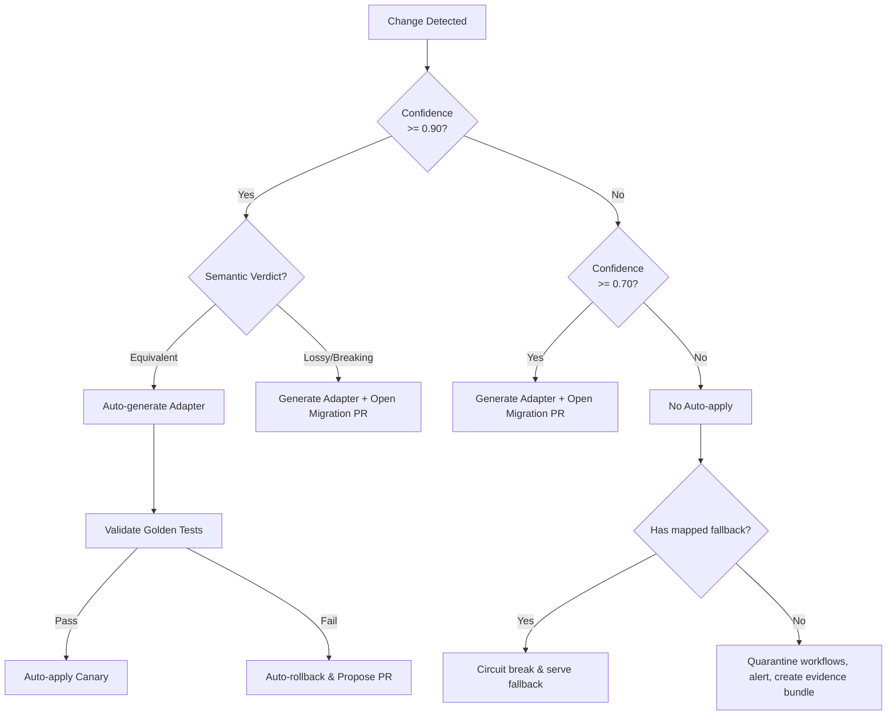

# Intra Data Model & API Specification

This document details the core data models, database schemas, REST APIs, and safe-handling rules for the Intra autonomous build harness.

## Table of Contents
1. [Core Type Definitions](#1-core-type-definitions)
2. [Database Schema](#2-database-schema)
3. [Engine REST API](#3-engine-rest-api)
4. [MCP Server Tools & Resources](#4-mcp-server-tools--resources)
5. [Simulated Services API](#5-simulated-services-api)
6. [Safe-Handling Decision Matrix](#6-safe-handling-decision-matrix)
7. [Zod Schema Examples](#7-zod-schema-examples)

---

## 1. Core Type Definitions

These interfaces reside in `packages/shared` and form the foundation of Intra's typing.

```typescript
/**
 * Records a single HTTP/Webhook/MCP request-response pair.
 */
export interface Observation {
  id: string;
  service: string;
  endpoint: string;
  method: string;
  status: number;
  headers: Record<string, string>;
  body: unknown;
  latencyMs: number;
  rateLimitHeaders?: Record<string, string>;
  paginationShape?: Record<string, unknown>;
  errorBody?: unknown;
  timestamp: string;
}

/**
 * Statistical fingerprint of field behaviour.
 */
export interface BehaviouralFingerprint {
  valueDistributions: Record<string, number>;
  units?: string;
  formats?: string[];
  cardinality: 'low' | 'high' | 'unique' | 'enum';
  defaults?: unknown[];
}

/**
 * Learned contract for a specific endpoint.
 */
export interface Contract {
  service: string;
  endpoint: string;
  schema: {
    types: Record<string, string>;
    optionality: string[];
    enums: Record<string, string[]>;
    formats: Record<string, string>;
  };
  fieldStats: Record<string, BehaviouralFingerprint>;
  errorTaxonomy: Record<string, unknown>;
  paginationStyle: 'cursor' | 'offset' | 'page' | 'link-header' | 'none';
  rateLimitPolicy?: { limit: number; window: string };
}

/**
 * Represents a detected change in contract or behaviour.
 * Exact schema from HARNESS.md §12.1.
 */
export interface Change {
  /** Unique identifier for the change event */
  id: string;
  /** Service where the change occurred */
  service: string;
  /** Endpoint where the change occurred */
  endpoint: string;
  /** Categorization of the semantic drift */
  kind: 'field_added' | 'field_removed' | 'type_changed' | 'rename' | 'unit_shift' | 
        'enum_semantics' | 'default_changed' | 'pagination_changed' | 'error_shape_changed' | 
        'rate_limit_changed' | 'truncation' | 'latency_regime' | 'semantic_other';
  /** Whether the change was documented in the published schema/changelog */
  documented: boolean;
  /** The state before the change */
  before: unknown;
  /** The state after the change */
  after: unknown;
  /** Evidence backing this change */
  evidence: { 
    samples: Observation['id'][]; 
    stats: Record<string, number> 
  };
  /** Safe-handling classification */
  semanticVerdict: 'equivalent' | 'lossy' | 'breaking' | 'unknown';
  /** Confidence score between 0.0 and 1.0 */
  confidence: number;
  /** ISO8601 timestamp of detection */
  detectedAt: string;
}

/**
 * Analysis of workflows affected by a change.
 */
export interface Impact {
  changeId: string;
  affectedWorkflows: string[];
  fieldPaths: string[];
  severity: 'low' | 'medium' | 'high' | 'critical';
  dependencyChain: string[];
}

/**
 * An adapter generated to resolve an equivalent/lossy drift.
 */
export interface Adapter {
  id: string;
  changeId: string;
  strategy: 'rename' | 'transform' | 'default-inject' | 'pagination-normalize' | 'retry-backoff';
  code: string;
  tests: string;
  rollbackHandle: string;
  appliedAt?: string;
}

/**
 * Result of validating an adapter against the change.
 */
export interface ValidationResult {
  adapterId: string;
  pass: boolean;
  semanticEquivalence: boolean;
  goldenTestResults: Record<string, boolean>;
  evidence: string;
}

/**
 * Represents a pull request proposal for manual review.
 */
export interface MigrationProposal {
  id: string;
  changeId: string;
  diff: string;
  rationale: string;
  riskAssessment: string;
  status: 'pending' | 'approved' | 'rejected';
}
```

---

## 2. Database Schema

Drizzle ORM definitions (Postgres/SQLite compatible) for the core domain.

```typescript
import { pgTable, text, timestamp, integer, jsonb, doublePrecision, boolean, index } from 'drizzle-orm/pg-core';

export const services = pgTable('services', {
  id: text('id').primaryKey(),
  name: text('name').notNull(),
  createdAt: timestamp('created_at').defaultNow().notNull()
});

export const endpoints = pgTable('endpoints', {
  id: text('id').primaryKey(),
  serviceId: text('service_id').references(() => services.id).notNull(),
  path: text('path').notNull(),
  method: text('method').notNull()
}, (table) => [
  index('endpoints_service_idx').on(table.serviceId)
]);

export const workflows = pgTable('workflows', {
  id: text('id').primaryKey(),
  name: text('name').notNull(),
  description: text('description')
});

export const observations = pgTable('observations', {
  id: text('id').primaryKey(),
  service: text('service').notNull(),
  endpoint: text('endpoint').notNull(),
  method: text('method').notNull(),
  status: integer('status').notNull(),
  headers: jsonb('headers').notNull(),
  body: jsonb('body'),
  latencyMs: integer('latency_ms').notNull(),
  rateLimitHeaders: jsonb('rate_limit_headers'),
  paginationShape: jsonb('pagination_shape'),
  errorBody: jsonb('error_body'),
  timestamp: timestamp('timestamp').notNull()
}, (table) => [
  index('observations_svc_ep_idx').on(table.service, table.endpoint)
]);

export const contracts = pgTable('contracts', {
  id: text('id').primaryKey(),
  service: text('service').notNull(),
  endpoint: text('endpoint').notNull(),
  schema: jsonb('schema').notNull(),
  fieldStats: jsonb('field_stats').notNull(),
  errorTaxonomy: jsonb('error_taxonomy').notNull(),
  paginationStyle: text('pagination_style').notNull(),
  rateLimitPolicy: jsonb('rate_limit_policy')
}, (table) => [
  index('contracts_svc_ep_idx').on(table.service, table.endpoint)
]);

export const changes = pgTable('changes', {
  id: text('id').primaryKey(),
  service: text('service').notNull(),
  endpoint: text('endpoint').notNull(),
  kind: text('kind').notNull(),
  documented: boolean('documented').notNull(),
  before: jsonb('before').notNull(),
  after: jsonb('after').notNull(),
  evidence: jsonb('evidence').notNull(),
  semanticVerdict: text('semantic_verdict').notNull(),
  confidence: doublePrecision('confidence').notNull(),
  detectedAt: timestamp('detected_at').notNull()
}, (table) => [
  index('changes_service_idx').on(table.service)
]);

export const impacts = pgTable('impacts', {
  id: text('id').primaryKey(),
  changeId: text('change_id').references(() => changes.id).notNull(),
  affectedWorkflows: jsonb('affected_workflows').notNull(),
  fieldPaths: jsonb('field_paths').notNull(),
  severity: text('severity').notNull(),
  dependencyChain: jsonb('dependency_chain').notNull()
});

export const adapters = pgTable('adapters', {
  id: text('id').primaryKey(),
  changeId: text('change_id').references(() => changes.id).notNull(),
  strategy: text('strategy').notNull(),
  code: text('code').notNull(),
  tests: text('tests').notNull(),
  rollbackHandle: text('rollback_handle').notNull(),
  appliedAt: timestamp('applied_at')
});

export const validationResults = pgTable('validation_results', {
  id: text('id').primaryKey(),
  adapterId: text('adapter_id').references(() => adapters.id).notNull(),
  pass: boolean('pass').notNull(),
  semanticEquivalence: boolean('semantic_equivalence').notNull(),
  goldenTestResults: jsonb('golden_test_results').notNull(),
  evidence: text('evidence').notNull()
});
```

**Migration Strategy**: Use Drizzle Kit to automatically generate SQL migration files that are applied sequentially via CI/CD (`pnpm db:migrate`).

---

## 3. Engine REST API

OpenAPI-style specification for the Fastify monolith.

### Observations & Contracts
- `POST /observe`
  - Body: `Observation`
  - Purpose: Submits a new HTTP/Webhook/MCP observation for contract learning.
- `GET /contracts/:service/:endpoint`
  - Returns: `Contract`
  - Purpose: Gets the active learned contract and behavioural fingerprint for an endpoint.
- `GET /services`
  - Returns: `Array<{ name: string, endpoints: string[] }>`
  - Purpose: Lists all services actively observed by Intra.

### Drift Detection
- `GET /changes`
  - Query Params: `service`, `since` (ISO date), `min_confidence` (float), `verdict` ('equivalent' | 'lossy' | 'breaking' | 'unknown')
  - Returns: `Change[]`
  - Purpose: Retrieve detected semantic drift.
- `GET /events` (SSE)
  - Purpose: Server-Sent Events endpoint streaming live drift notifications (e.g. for dashboard/UI).

### Analysis & Remediation
- `GET /impact/:changeId`
  - Returns: `Impact`
  - Purpose: Fetch dependency graph blast radius for a given change.
- `POST /adapt/:changeId`
  - Returns: `{ adapter: Adapter, validation: ValidationResult, proposal?: MigrationProposal }`
  - Purpose: Triggers adapter generation and validation. Follows the Safe-Handling policy (§10).
- `POST /apply/:proposalId`
  - Body: `{ confirm: boolean }`
  - Purpose: Gated endpoint to apply a proposed adapter if human confirmation is required.

### System
- `GET /health`
  - Returns: `{ status: 'ok', uptime: number, dependencies: Record<string, string>, rateLimitHeadroom: Record<string, number> }`

---

## 4. MCP Server Tools & Resources

Located in `mcpserver/` and built using `@modelcontextprotocol/sdk`. Exposes Intra's capabilities to customer LLM agents.

### Tool Definitions
1. **`intra_list_dependencies`**
   - *Params:* None
   - *Returns:* List of services and endpoints being observed.
2. **`intra_get_contract`**
   - *Params:* `service` (string), `endpoint` (string)
   - *Returns:* Learned schema and behavioural fingerprint.
3. **`intra_recent_changes`**
   - *Params:* `service` (optional string), `since` (optional ISO string), `min_confidence` (optional float)
   - *Returns:* Array of `Change` records.
4. **`intra_impact`**
   - *Params:* `change_id` (optional string), `field_path` (optional string)
   - *Returns:* The `Impact` object detailing affected workflows.
5. **`intra_propose_adapter`**
   - *Params:* `change_id` (string)
   - *Returns:* A diff of the adapter code and validation test plan (does *not* execute it).
6. **`intra_apply_adapter`**
   - *Params:* `proposal_id` (string), `confirm` (boolean)
   - *Returns:* Success status of applying the generated adapter, gated by policy.
7. **`intra_health`**
   - *Params:* None
   - *Returns:* Health metrics and rate-limit headroom.

### Resources
- `intra://contracts/{service}`: Aggregated contract dump for a given service.
- `intra://changes/latest`: Read-only view of the latest active drifts across all services.

### Auth Model
- **API Key**: Required via HTTP headers or initial transport handshake.
- **Tenant Scoping**: Keys restrict visibility of data to the organization's specific services.
- **Audit Log**: Every tool execution is recorded with timestamp, tenant ID, and parameters.

---

## 5. Simulated Services API

Simulated external services (`packages/sim-services`) for end-to-end testing and demos. Includes a switchboard to dynamically inject undocumented changes.

### Sim Services
- **Users API**
  - `GET /users` -> Returns `[{ name: "..." }]`
  - Mutations:
    - **M1**: `name` -> `display_name` (rename, equivalent)
    - **M2**: `name` format flips from "First Last" to "Last, First" (format change, lossy)
    - **M10**: `status` enum `active` semantics change to include suspended (breaking)
- **Payments API**
  - `POST /charges`, `GET /charges/:id` -> Returns `{ amount: 15.50, currency: "USD" }`
  - Mutations:
    - **M3**: `amount` from float (dollars) to int (cents) (unit shift, equivalent)
    - **M4**: Default `currency` flips USD to EUR (default change, lossy/breaking)
    - **M8**: 429 Rate Limit introduced at 5 rps with new `Retry-After` shape (rate limit change)
- **Search API**
  - `GET /search?q=...&offset=0` -> Returns paginated items
  - Mutations:
    - **M5**: `offset` replaced by opaque `cursor` (pagination change)
    - **M6**: Silent cap on page size from 100 to 20 (truncation)
- **Notifications API** (Webhook)
  - Payload format: `{ "event": { "type": "payment_failed" } }`
  - Mutations:
    - **M7**: Payload flattened to `{ "type": "payment_failed" }` (structural + semantic)
- **MCP-Tool Service**
  - Tool arguments schema for a remote MCP server
  - Mutations:
    - **M9**: arg `query` becomes `q` and requires a new `limit` argument.

### Switchboard API
- `POST /sim/switchboard/toggle`
  - Body: `{ mutationId: string, active: boolean }`
  - Purpose: Turns on/off specific undocumented mutations (M1-M10) during the demo.

---

## 6. Safe-Handling Decision Matrix



### Breakdown & Evidence
- **Confidence thresholds**:
  - `≥ 0.90`: Automated safe repair (e.g. rename with high overlap).
  - `0.70 - 0.89`: Semi-autonomous repair (requires PR review).
  - `< 0.70`: Manual intervention, anomaly flagged.
- **Evidence Bundle Schema**: Captured diff snippets, statistical deviance metrics, and workflow dependency graph highlighting the point of failure.
- **Rollback Mechanism**: Every adapter encapsulates a `rollbackHandle` function. If post-apply validation regressions occur within a predefined canary window, the engine invokes this handle to revert the middleware safely.

---

## 7. Zod Schema Examples

Types defined in `packages/shared` must be mirrored as Zod schemas for Fastify API validation.

```typescript
import { z } from 'zod';

export const ChangeSchema = z.object({
  id: z.string().uuid(),
  service: z.string(),
  endpoint: z.string(),
  kind: z.enum([
    'field_added', 'field_removed', 'type_changed', 'rename', 'unit_shift',
    'enum_semantics', 'default_changed', 'pagination_changed', 'error_shape_changed',
    'rate_limit_changed', 'truncation', 'latency_regime', 'semantic_other'
  ]),
  documented: z.boolean(),
  before: z.unknown(),
  after: z.unknown(),
  evidence: z.object({
    samples: z.array(z.string()),
    stats: z.record(z.number())
  }),
  semanticVerdict: z.enum(['equivalent', 'lossy', 'breaking', 'unknown']),
  confidence: z.number().min(0).max(1),
  detectedAt: z.string().datetime()
});

export const ApplyProposalRequestSchema = z.object({
  confirm: z.boolean()
});
```
