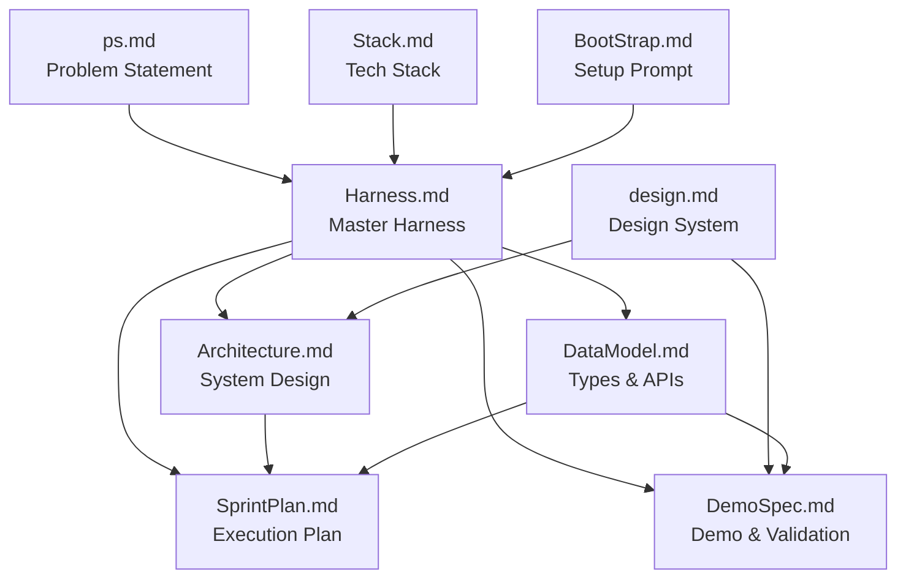

# Intra Documentation Index

> **Last updated:** 2026-10-10  
> **Project:** Intra — Infrastructure that lets software survive undocumented changes in external services

---

## Quick Navigation

| # | Document | Purpose | Audience |
|---|---|---|---|
| 1 | [Problem Statement](ps.md) | What we're solving, why, and what success looks like | Everyone |
| 2 | [Harness](Harness.md) | Master build harness — mission, principles, agents, sprints, gates | All agents |
| 3 | [Architecture](Architecture.md) | System architecture, pipeline deep-dive, deployment topology | Architects, devs |
| 4 | [Sprint Plan](SprintPlan.md) | 40 tasks across 7 sprints with waves, deps, acceptance criteria | Orchestrator, all agents |
| 5 | [Data Model & API](DataModel.md) | TypeScript types, DB schema, REST API, MCP tools, Zod schemas | All devs |
| 6 | [Demo Specification](DemoSpec.md) | Mutation catalogue (M1-M10), demo script, E2E assertions | QA, sim-dev, validator-dev |
| 7 | [Design System](design.md) | Washi & Crimson tokens, typography, motifs, severity mapping | web-dev |
| 8 | [Tech Stack](Stack.md) | Locked technology decisions and env contracts | All agents |
| 9 | [Bootstrap](BootStrap.md) | One-shot setup prompt for fresh clone | Orchestrator |

---

## Document Dependency Map

---

## Reading Order

### For New Engineers / Agents
1. **Start with** [ps.md](ps.md) — understand the problem
2. **Read** [Harness.md §0–§2](Harness.md) — mission, principles, token rules
3. **Scan** [Architecture.md](Architecture.md) — how the system works
4. **Check** [SprintPlan.md](SprintPlan.md) — find your assigned tasks

### For Orchestrator / Lead
1. [Harness.md](Harness.md) — full read
2. [SprintPlan.md](SprintPlan.md) — task graph and wave planning
3. [DataModel.md](DataModel.md) — shared type contracts
4. [DemoSpec.md](DemoSpec.md) — definition of done

### For QA Engineer
1. [DemoSpec.md](DemoSpec.md) — mutation catalogue and assertions
2. [DataModel.md §6](DataModel.md#6-safe-handling-decision-matrix) — safe-handling policy
3. [Harness.md §8](Harness.md) — quality gates

### For Web Developer
1. [design.md](design.md) — Washi & Crimson design system
2. [Architecture.md §5](Architecture.md#5-deployment-architecture) — deployment topology
3. [DemoSpec.md §7](DemoSpec.md#7-dashboard-demo-walkthrough) — dashboard requirements

---

## Coverage Matrix

This matrix maps every requirement from the problem statement to the document that specifies it:

| Requirement (from ps.md) | Specified In | Tasks |
|---|---|---|
| Observe external dependencies | [Architecture.md §2.1](Architecture.md#observer-packagesobserver) | T-011 |
| Learn real behaviour (not just schemas) | [Architecture.md §2.2](Architecture.md#model-packagesmodel) | T-020, T-021, T-022 |
| Detect meaningful changes | [Architecture.md §2.3](Architecture.md#differ-packagesdiffer) | T-030, T-031, T-032, T-034 |
| Assess affected application parts | [Architecture.md §2.4](Architecture.md#impact-packagesimpact) | T-040, T-041 |
| Automatically adapt or propose migration | [Architecture.md §2.5](Architecture.md#adapter-packagesadapter) | T-042, T-043 |
| Validate adaptations | [Architecture.md §2.6](Architecture.md#validator-packagesvalidator) | T-050, T-051 |
| Confidence scoring & semantic verdicts | [DataModel.md §1](DataModel.md#1-core-type-definitions) | T-034 |
| Safe auto-repair policy | [DataModel.md §6](DataModel.md#6-safe-handling-decision-matrix) | T-043 |
| Demo with simulated services | [DemoSpec.md](DemoSpec.md) | T-012, T-013, T-052, T-055, T-056 |
| MCP server for customer querying | [DataModel.md §4](DataModel.md#4-mcp-server-tools--resources) | T-053 |

---

## Stats

- **Total documents:** 9
- **Total tasks planned:** 40 (across 7 sprints)
- **Core types defined:** 8 (Observation, Contract, BehaviouralFingerprint, Change, Impact, Adapter, ValidationResult, MigrationProposal)
- **REST API endpoints:** 9
- **MCP tools:** 7
- **Simulated services:** 5
- **Mutations catalogued:** 10 (M1–M10)
- **Agents in roster:** 15
