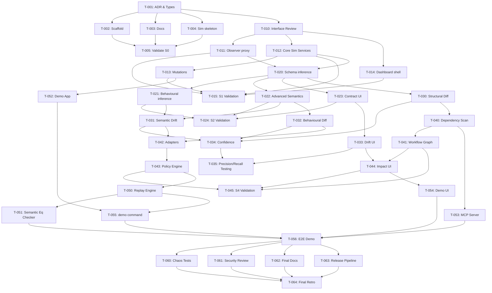
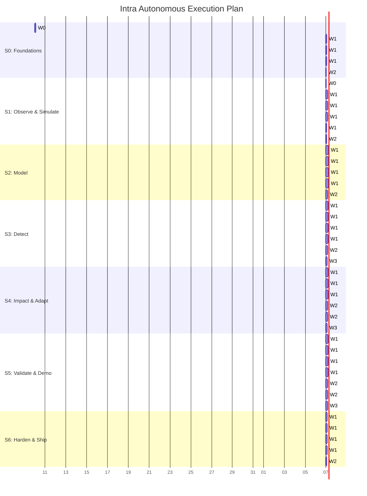

# Intra: Sprint Execution Plan

## 1. Sprint Overview

| Sprint | Name | Duration Estimate | Key Deliverables | Exit Criteria | Risk Level |
|---|---|---|---|---|---|
| **0** | Foundations | 1 day | Shared types, monorepo setup, pipeline | CI green, first PR merged autonomously | Low |
| **1** | Observe & Simulate | 2 days | Observer, sim-services, dashboard shell | Traffic captured with ≥99% fidelity | Medium |
| **2** | Model | 3 days | Contract inference, behavioral fingerprints | Models built from traffic, visible in UI | High |
| **3** | Detect | 3 days | Structural & semantic drift detection | Recall ≥0.95, precision ≥0.90 on mutations | High |
| **4** | Impact & Adapt | 3 days | Dependency graph, adapters, migration PRs | Adapter or proposal produced per policy | High |
| **5** | Validate & Demo | 2 days | Replay engine, semantic equivalence, MCP | Demo script passes in CI | Medium |
| **6** | Harden & Ship | 2 days | Chaos tests, security, docs, v1.0.0 | v1.0.0 tagged, ready for public demo | Low |

---

## 2. Sprint 0: Foundations

### T-001 · architect: ADR-001 pipeline & data model
- **agent**: architect
- **deps**: none
- **paths**: `docs/adr/*`, `packages/shared/**`
- **accept**:
  - [ ] Publish `Observation`, `Contract`, `Change`, `Impact`, `Adapter`, `ValidationResult` interfaces
  - [ ] Lock STACK.md rules
- **wave**: W0
- **status**: todo

### T-002 · devops: Monorepo scaffold
- **agent**: devops
- **deps**: T-001
- **paths**: `.github/**`, `package.json`, `tsconfig.json`, `pnpm-workspace.yaml`
- **accept**:
  - [ ] Setup pnpm, Turborepo, Vitest, ESLint, husky
  - [ ] GitHub Actions CI skeleton
- **wave**: W1
- **status**: todo

### T-003 · scribe: Docs skeleton
- **agent**: scribe
- **deps**: T-001
- **paths**: `README.md`, `docs/**`
- **accept**:
  - [ ] Setup CLAUDE.md/AGENTS.md pointers
  - [ ] Write README skeleton
- **wave**: W1
- **status**: todo

### T-004 · sim-dev: Sim service skeleton
- **agent**: sim-dev
- **deps**: T-001
- **paths**: `packages/sim-services/**`
- **accept**:
  - [ ] Basic Fastify server structure
  - [ ] Mutation switchboard API contract
- **wave**: W1
- **status**: todo

### T-005 · qa-engineer: Validate scaffold
- **agent**: qa-engineer
- **deps**: T-002, T-003, T-004
- **paths**: `**/*.test.ts`
- **accept**:
  - [ ] Gates run green on empty packages
- **wave**: W2
- **status**: todo

---

## 3. Sprint 1: Observe & Simulate

### T-010 · architect: Interface review of observer/sim contracts
- **agent**: architect
- **deps**: T-001
- **paths**: `packages/shared/**`
- **accept**:
  - [ ] Observer and sim service API interfaces finalized
- **wave**: W0
- **status**: todo

### T-011 · observer-dev: HTTP capture proxy + SDK wrapper
- **agent**: observer-dev
- **deps**: T-010
- **paths**: `packages/observer/**`, `packages/sdk/**`
- **accept**:
  - [ ] PII redaction mechanism
  - [ ] Storage to `observations` table/store
  - [ ] Webhook receiver implemented
- **wave**: W1
- **status**: todo

### T-012 · sim-dev: Core simulated services
- **agent**: sim-dev
- **deps**: T-010
- **paths**: `packages/sim-services/**`
- **accept**:
  - [ ] Implement Users, Payments, Search, Notifications webhook, and MCP-tool service
- **wave**: W1
- **status**: todo

### T-013 · sim-dev: Mutation catalogue v1
- **agent**: sim-dev
- **deps**: T-012
- **paths**: `packages/sim-services/**`
- **accept**:
  - [ ] Implement 10 documented mutations togglable via switchboard
- **wave**: W1
- **status**: todo

### T-014 · web-dev: Dashboard shell
- **agent**: web-dev
- **deps**: T-010
- **paths**: `apps/web/**`
- **accept**:
  - [ ] React 18 + Vite setup
  - [ ] Layout, auth stub, Services list page
- **wave**: W1
- **status**: todo

### T-015 · qa-engineer: Traffic fidelity tests
- **agent**: qa-engineer
- **deps**: T-011, T-012, T-013, T-014
- **paths**: `tests/int/**`
- **accept**:
  - [ ] Verify traffic from demo-app to sim services captured with ≥99% fidelity
- **wave**: W2
- **status**: todo

---

## 4. Sprint 2: Model

### T-020 · model-dev: Schema inference
- **agent**: model-dev
- **deps**: T-011, T-012
- **paths**: `packages/model/**`
- **accept**:
  - [ ] Infer types, optionality, enums, formats from captured traffic
- **wave**: W1
- **status**: todo

### T-021 · model-dev: Behavioural fingerprint
- **agent**: model-dev
- **deps**: T-020
- **paths**: `packages/model/**`
- **accept**:
  - [ ] Extract value distributions, units, defaults, cardinality
- **wave**: W1
- **status**: todo

### T-022 · model-dev: Advanced semantics
- **agent**: model-dev
- **deps**: T-020
- **paths**: `packages/model/**`
- **accept**:
  - [ ] Error taxonomy, pagination detector (cursor/offset/page/link-header)
  - [ ] Rate-limit policy learner
- **wave**: W1
- **status**: todo

### T-023 · web-dev: Contract viewer UI
- **agent**: web-dev
- **deps**: T-020
- **paths**: `apps/web/**`
- **accept**:
  - [ ] Display per-endpoint models and field statistics
- **wave**: W1
- **status**: todo

### T-024 · qa-engineer: Inference validation
- **agent**: qa-engineer
- **deps**: T-021, T-022, T-023
- **paths**: `tests/int/**`
- **accept**:
  - [ ] Property-based tests pass; models handle noisy data gracefully
- **wave**: W2
- **status**: todo

---

## 5. Sprint 3: Detect

### T-030 · differ-dev: Structural diff
- **agent**: differ-dev
- **deps**: T-020
- **paths**: `packages/differ/**`
- **accept**:
  - [ ] Detect additions, removals, type changes, nullability changes
- **wave**: W1
- **status**: todo

### T-031 · differ-dev: Semantic drift
- **agent**: differ-dev
- **deps**: T-021, T-022
- **paths**: `packages/differ/**`
- **accept**:
  - [ ] Rename candidates, unit/scale shift, enum meaning change
  - [ ] Default flip, timezone/format change
- **wave**: W1
- **status**: todo

### T-032 · differ-dev: Behavioural diff
- **agent**: differ-dev
- **deps**: T-022
- **paths**: `packages/differ/**`
- **accept**:
  - [ ] Pagination change, error shape change, rate-limit change
  - [ ] Silent truncation, latency regime shift
- **wave**: W1
- **status**: todo

### T-033 · web-dev: Drift feed UI
- **agent**: web-dev
- **deps**: T-023
- **paths**: `apps/web/**`
- **accept**:
  - [ ] Render drift feed with severity and confidence scores
- **wave**: W1
- **status**: todo

### T-034 · differ-dev: Confidence & false-positives
- **agent**: differ-dev
- **deps**: T-030, T-031, T-032
- **paths**: `packages/differ/**`
- **accept**:
  - [ ] Confidence scoring and statistical window suppression
- **wave**: W2
- **status**: todo

### T-035 · qa-engineer: Precision/recall reporting
- **agent**: qa-engineer
- **deps**: T-034, T-033
- **paths**: `tests/int/**`
- **accept**:
  - [ ] Test benign vs malicious corpus; recall ≥0.95, precision ≥0.90
- **wave**: W3
- **status**: todo

---

## 6. Sprint 4: Impact & Adapt

### T-040 · impact-dev: Static & runtime dependency scanning
- **agent**: impact-dev
- **deps**: T-030
- **paths**: `packages/impact/**`
- **accept**:
  - [ ] AST parsing for field usage
  - [ ] Runtime trace correlation
- **wave**: W1
- **status**: todo

### T-041 · impact-dev: Workflow graph
- **agent**: impact-dev
- **deps**: T-040
- **paths**: `packages/impact/**`
- **accept**:
  - [ ] Generate workflow graph and answer blast-radius queries
- **wave**: W1
- **status**: todo

### T-042 · adapter-dev: Adapter generators
- **agent**: adapter-dev
- **deps**: T-031, T-032
- **paths**: `packages/adapter/**`
- **accept**:
  - [ ] Rename, transform, default injection, pagination normalizer, retry
- **wave**: W1
- **status**: todo

### T-043 · adapter-dev: Safe-handling policy engine
- **agent**: adapter-dev
- **deps**: T-042
- **paths**: `packages/adapter/**`
- **accept**:
  - [ ] Migration PR generator, rollback handles based on confidence (§10)
- **wave**: W1
- **status**: todo

### T-044 · web-dev: Impact & Review UI
- **agent**: web-dev
- **deps**: T-033, T-041
- **paths**: `apps/web/**`
- **accept**:
  - [ ] Visual impact view and adapter/proposal review screens
- **wave**: W1
- **status**: todo

### T-045 · qa-engineer: Adapter validation
- **agent**: qa-engineer
- **deps**: T-041, T-043, T-044
- **paths**: `tests/int/**`
- **accept**:
  - [ ] Correct adapters generated for catalogue mutations
- **wave**: W2
- **status**: todo

---

## 7. Sprint 5: Validate & Demo

### T-050 · validator-dev: Replay engine
- **agent**: validator-dev
- **deps**: T-043
- **paths**: `packages/validator/**`
- **accept**:
  - [ ] Replay recorded workflows against adapted service, golden assertions
- **wave**: W1
- **status**: todo

### T-051 · validator-dev: Semantic-equivalence checker
- **agent**: validator-dev
- **deps**: T-050
- **paths**: `packages/validator/**`
- **accept**:
  - [ ] Verify semantic meaning preservation across adaptations
- **wave**: W1
- **status**: todo

### T-052 · sim-dev: Demo app workflows
- **agent**: sim-dev
- **deps**: T-013
- **paths**: `apps/demo-app/**`
- **accept**:
  - [ ] Shipwell workflows (checkout, search, etc.) implemented
- **wave**: W1
- **status**: todo

### T-053 · mcp-dev: Customer MCP server
- **agent**: mcp-dev
- **deps**: T-040
- **paths**: `mcpserver/**`
- **accept**:
  - [ ] Expose standard tools/resources matching the API spec
- **wave**: W1
- **status**: todo

### T-054 · web-dev: Live demo console
- **agent**: web-dev
- **deps**: T-044
- **paths**: `apps/web/**`
- **accept**:
  - [ ] Mutation toggles, timeline view, before/after adapter state
- **wave**: W1
- **status**: todo

### T-055 · validator-dev: Single command orchestration
- **agent**: validator-dev
- **deps**: T-050, T-052
- **paths**: `packages/validator/**`
- **accept**:
  - [ ] `pnpm demo` orchestration working seamlessly
- **wave**: W2
- **status**: todo

### T-056 · qa-engineer: E2E Demo assertions
- **agent**: qa-engineer
- **deps**: T-051, T-053, T-054, T-055
- **paths**: `tests/e2e/**`
- **accept**:
  - [ ] Full demo script tests pass in CI
- **wave**: W3
- **status**: todo

---

## 8. Sprint 6: Harden & Ship

### T-060 · qa-engineer: Chaos & Performance
- **agent**: qa-engineer
- **deps**: T-056
- **paths**: `tests/e2e/**`
- **accept**:
  - [ ] Chaos tests pass (flapping, partial outage)
  - [ ] Performance budget verified
- **wave**: W1
- **status**: todo

### T-061 · reviewer: Security review
- **agent**: reviewer
- **deps**: T-056
- **paths**: `**/*`
- **accept**:
  - [ ] Threat model validation (PII, SSRF, code injection)
- **wave**: W1
- **status**: todo

### T-062 · scribe: Final Documentation
- **agent**: scribe
- **deps**: T-056
- **paths**: `docs/**`, `README.md`
- **accept**:
  - [ ] Arch diagram, quick-start, and MCP usage guide complete
- **wave**: W1
- **status**: todo

### T-063 · devops: Release pipeline
- **agent**: devops
- **deps**: T-056
- **paths**: `.github/**`
- **accept**:
  - [ ] Container images built, dashboard deployed, v1.0.0 tagged
- **wave**: W1
- **status**: todo

### T-064 · orchestrator: Final Retro & Promises
- **agent**: orchestrator
- **deps**: T-060, T-061, T-062, T-063
- **paths**: `.harness/STATE.md`
- **accept**:
  - [ ] Emit `<promise>ALL_COMPLETE</promise>`
- **wave**: W2
- **status**: todo

---

## 9. Dependency Graph

---

## 10. Risk Matrix

| Risk | Sprint | Likelihood | Impact | Mitigation |
|---|---|---|---|---|
| Ambiguous schema inference from low traffic | 2 | High | High | Fall back to structural models initially; run extensive fuzz/sim traffic |
| False positives in semantic drift | 3 | Medium | High | Strict confidence gating, statistical sliding windows, tuning on benign corpus |
| Unsafe adapter generation breaks downstream | 4 | Low | Critical | Replay validation + Semantic-equivalence checking prior to proposal |
| High memory footprint in monolith engine | 6 | Medium | Medium | Stream processing for proxies, strict limits on buffered observations |

---

## 11. Parallel Execution Plan

