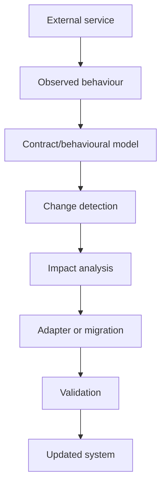

# Intra: The Internet After the API

**Executive Summary**
Modern software relies heavily on external services like APIs, SDKs, MCP servers, and webhooks, which are inherently fragile. Intra is an autonomous infrastructure layer designed to observe dependencies in real time, detect undocumented changes, and gracefully adapt running applications to survive semantic drift. By focusing on behavioral learning over rigid schemas, Intra automatically repairs compatible changes and isolates breaking ones before they cause systemic failure.

## 1. Problem Domain

APIs, SDKs, MCP servers, and webhooks are structurally fragile because software teams do not control the lifecycle of their dependencies. Providers frequently introduce **undocumented changes**—subtle modifications that aren't broadcast in schemas or changelogs. These include altering default values, shifting data units (e.g., from dollars to cents), swapping pagination styles, enforcing new rate limits, or silently truncating lists. Even when data remains valid JSON, its semantic meaning can drift, causing dependent applications to silently fail or act incorrectly. 

## 2. Core Challenge Statement

**The Challenge:** Build a system that observes external dependencies, learns their true runtime behavior, detects meaningful structural and semantic changes, assesses which parts of an application are affected, and automatically adapts the application—or safely proposes a migration when auto-repair is too risky.

## 3. System Pipeline

- **Observed behaviour**: Capture raw traffic (requests, responses, errors, latency, headers).
- **Contract/behavioural model**: Infer schemas and statistical fingerprints (distributions, units, defaults) from live traffic.
- **Change detection**: Continuously compare models to spot structural changes and semantic drift.
- **Impact analysis**: Map the exact workflows and fields dependent on the altered API endpoints.
- **Adapter or migration**: Generate backward-compatible runtime adapters or propose human-reviewed migrations based on confidence.
- **Validation**: Replay workflows through the adapter to ensure regressions are avoided.
- **Updated system**: Deploy the validated adapter into production, making workflows green again.

## 4. Illustrative Scenarios

Intra detects and handles real-world API mutations seamlessly:

1. **Field Rename:** An endpoint previously returning `GET /users -> name` silently changes to return `display_name`. Intra detects the high value overlap, classifies it as a rename (confidence ≥ 0.9), automatically generates a mapping adapter, and restores broken workflows.
2. **Unit Shift:** A payments API alters the `amount` field from dollars (float) to cents (integer). Intra detects the unit shift, crafts a `x0.01` transformation adapter, and applies it safely.
3. **Pagination Change:** A search endpoint replaces offset-based pagination with opaque cursors. Intra intercepts the change, applies a pagination normalizer, and seamlessly maps legacy offset requests to cursor tokens.
4. **Semantic Enum Shift:** A `status` enum `active` now starts including suspended users. This changes the semantic meaning entirely. Intra detects the drift, flags it as a *breaking/unknown* change, quarantines the workflow, and escalates it to a human.

## 5. Key Requirements

1. **Behaviour-First Detection**: Do not rely purely on documented schemas. Learn the real behaviour (defaults, paginations, error formats) by analyzing raw live traffic.
2. **Confidence Scoring & Semantic Verdicts**: Every detected change must receive a confidence score and a semantic verdict: `equivalent`, `lossy`, `breaking`, or `unknown`.
3. **Safe Auto-Repair Policy**: Auto-apply fixes only when confidence is high (≥ 0.90) and the change is equivalent. Otherwise, generate a migration proposal (PR) or circuit-break the dependency.
4. **Demo with Simulated Services**: The system must be demonstrable via a dummy application dependent on simulated external services that inject live, undocumented mutations.
5. **Customer MCP Server**: Expose an MCP server allowing users to query Intra (contracts, drift, impact, proposals) directly from their own agents.

## 6. Success Criteria

A strong solution demonstrates:
- Accurate and early detection of undocumented API changes.
- Pinpoint-accurate dependency and blast-radius mapping.
- Semantics-aware compatibility fixes (adapters) generation.
- Automated regression validation using traffic replay.
- Safe failure modes when automatic repair confidence is low (quarantine and escalation).
- Execution of the complete Demo Script from a clean clone with all assertions passing in CI.

## 7. Technical Constraints

The architecture is locked to a defined stack:
- **Language**: TypeScript (strict), Node 20+
- **Monorepo**: pnpm workspaces + Turborepo
- **Core App**: Fastify monolith encapsulating all pipeline modules
- **Frontend**: React 18, Vite, Tailwind, shadcn/ui, following the "Washi & Crimson" design system
- **State/Data**: Postgres (Railway) with Drizzle ORM, SQLite for local dev
- **Customer MCP**: Deployed as a separate Node/TS package on Render

## 8. Non-Goals

- **Not a standard API Gateway**: Intra is not designed for load balancing, rate limiting enforcement, or generic proxy routing.
- **Not just Schema Validation**: Validating against an OpenAPI spec is insufficient; Intra detects behavioral and semantic drift within valid schemas.
- **Not an Application Performance Monitor (APM)**: Intra focuses on dependency contract evolution, not just measuring latency and uptime.

## 9. Cross-References

- [Harness & Architecture](file:///D:/Workspace/Projects/Intra/docs/Harness.md)
- [Tech Stack Overview](file:///D:/Workspace/Projects/Intra/docs/Stack.md)
- [Design System (Washi & Crimson)](file:///D:/Workspace/Projects/Intra/docs/design.md)
